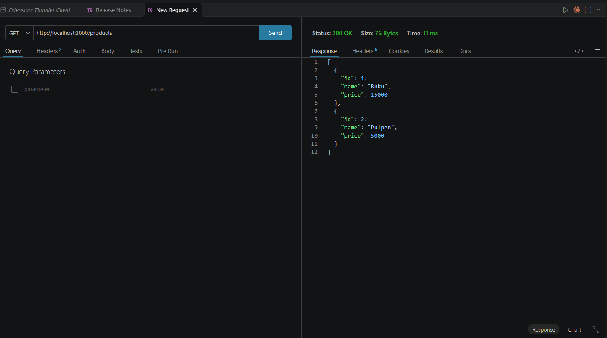
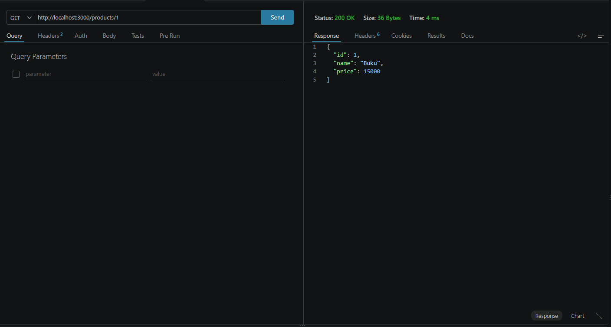
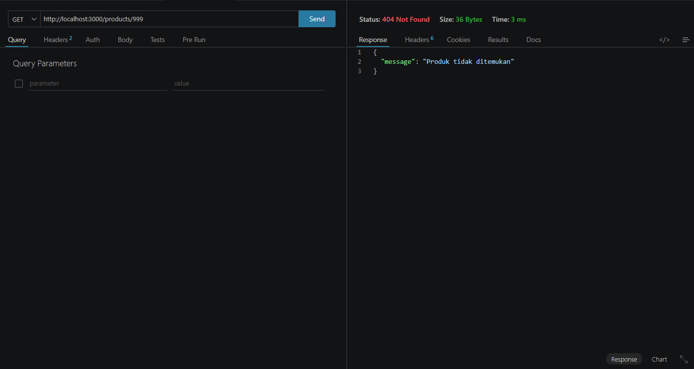
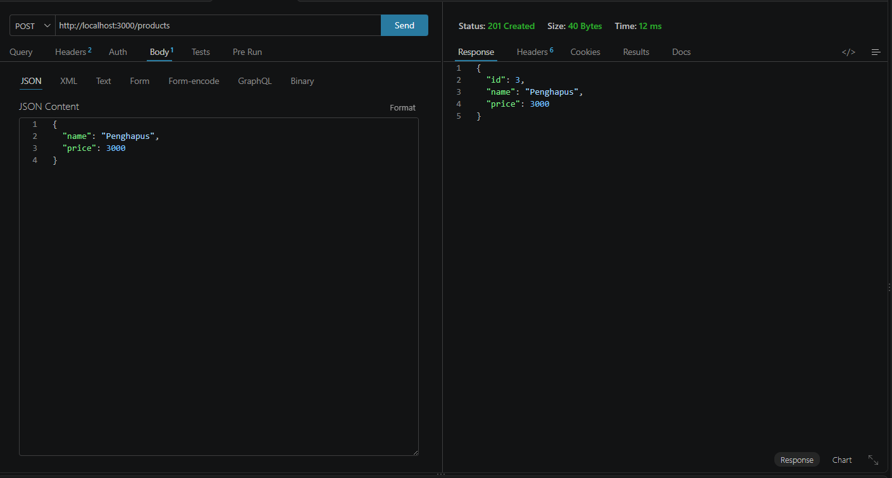
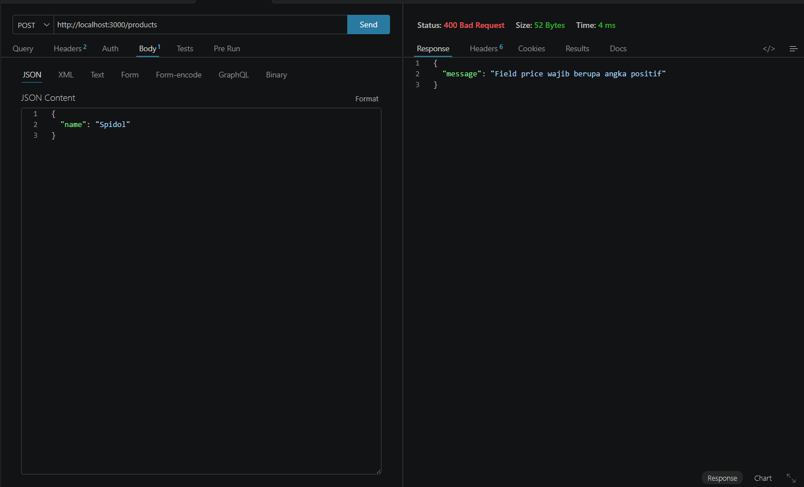
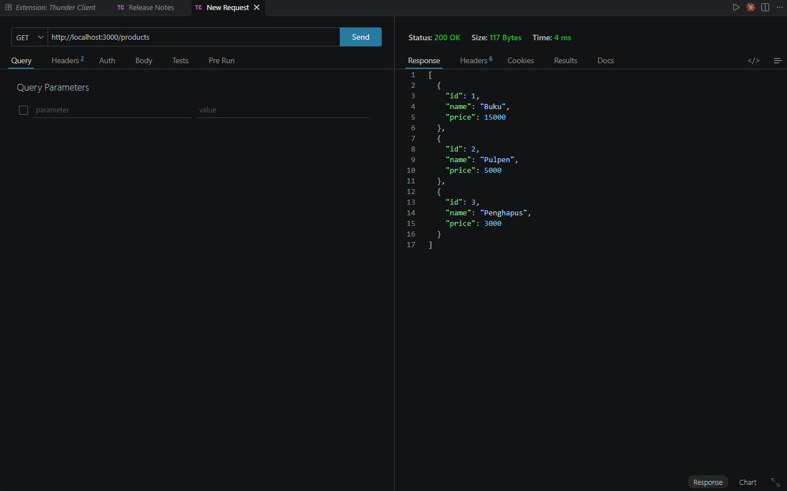

# Bukti Pengujian

Pengujian dilakukan dengan **Thunder Client** (ekstensi VS Code) terhadap server lokal
`http://localhost:3000` yang dijalankan dengan `npm start`.

Transkrip terminal di bagian bawah dihasilkan dengan `curl` sebagai pelengkap.

## 1. GET /products

Mengambil seluruh produk.



Status `200 OK`, body berisi array dua produk awal.

## 2. GET /products/1

Mengambil satu produk berdasarkan id.



Status `200 OK`, body berisi satu objek produk.

## 3. GET /products/999 (id tidak ditemukan)



Status `404 Not Found`, body berisi pesan JSON `{"message": "Produk tidak ditemukan"}`.

## 4. POST /products

Menambah produk baru. Tab Body menunjukkan JSON yang dikirim.



Status `201 Created`, body berisi produk baru beserta `id` yang dibuat server.

## 5. POST /products tanpa price (validasi)

Body sengaja dikirim tanpa field `price`.



Status `400 Bad Request`, body berisi pesan JSON yang menjelaskan field mana yang kurang.

## 6. GET /products setelah POST

Membuktikan produk hasil POST benar-benar tersimpan di array, bukan hanya dibalas sekali.



Status `200 OK`, body kini berisi tiga produk termasuk Penghapus dengan `id` 3.

## Transkrip terminal

Hasil nyata dari `curl`, dijalankan pada server yang baru dinyalakan.

### GET /products

```bash
curl -i http://localhost:3000/products
```

Status `200`

```json
[{"id":1,"name":"Buku","price":15000},{"id":2,"name":"Pulpen","price":5000}]
```

### GET /products/1

```bash
curl -i http://localhost:3000/products/1
```

Status `200`

```json
{"id":1,"name":"Buku","price":15000}
```

### GET /products/999

```bash
curl -i http://localhost:3000/products/999
```

Status `404`

```json
{"message":"Produk tidak ditemukan"}
```

### POST /products

```bash
curl -i -X POST http://localhost:3000/products \
  -H "Content-Type: application/json" \
  -d '{"name":"Penghapus","price":3000}'
```

Status `201`

```json
{"id":3,"name":"Penghapus","price":3000}
```

### POST /products tanpa price (validasi)

```bash
curl -i -X POST http://localhost:3000/products \
  -H "Content-Type: application/json" \
  -d '{"name":"Spidol"}'
```

Status `400`

```json
{"message":"Field price wajib berupa angka positif"}
```

### GET /products setelah POST

```bash
curl -i http://localhost:3000/products
```

Status `200`

```json
[{"id":1,"name":"Buku","price":15000},{"id":2,"name":"Pulpen","price":5000},{"id":3,"name":"Penghapus","price":3000}]
```
